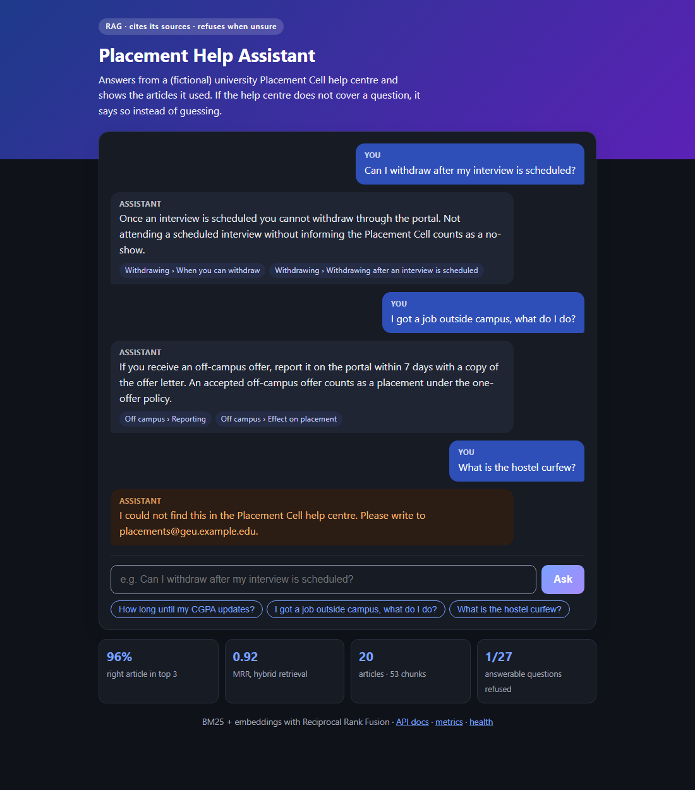
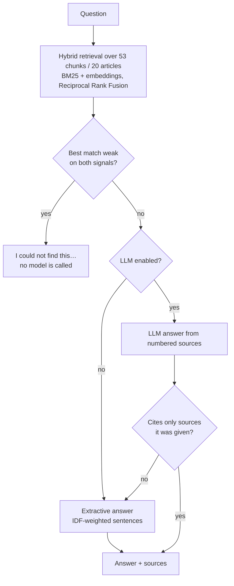

# AI Knowledge & Support Assistant

Answers student questions about a (fictional) university Placement Cell from its help-centre articles, with
**source references**, and says **"I could not find this"** instead of guessing when the articles do not cover the
question. Retrieval-augmented generation (RAG) with an evaluation set.

Python · BM25 · embeddings (LSA / sentence-transformers / API) · LLM API (optional) · FastAPI · pytest

**[Full documentation (PDF)](docs/AI_Support_Assistant_Documentation.pdf)**





Open `http://127.0.0.1:8000/` after `uvicorn assistant.api:app` for the chat page (`/?q=your+question` links ask a question on load). **Deploy a live demo:** on
[Render](https://render.com) choose *New + → Blueprint* and pick this repo (`render.yaml` is included).

## Run

```powershell
python -m venv .venv
.venv\Scripts\activate
pip install -r requirements.txt
python -m assistant.cli "Can I withdraw after my interview is scheduled?"
python -m assistant.cli                      # interactive
uvicorn assistant.api:app --reload           # POST /ask {"question": "..."}; docs at /docs
python -m pytest -q                          # 15 tests
python eval/run_eval.py                      # evaluation (offline)
docker build -t ai-support-assistant . ; docker run -p 8000:8000 ai-support-assistant
```

The API returns `X-Request-ID` on every response, logs one JSON line per question (outcome, sources, latency;
never the question text) and serves `/metrics` (answered vs refused, refusal rate, p50/p95 latency).
CI (`.github/workflows/ci.yml`) runs the tests, re-runs the evaluation and **fails the build if hybrid recall@3 drops
below 0.90**, then builds the Docker image.

Optional:
- LLM answers: set `GROQ_API_KEY` (or `LLM_API_KEY` + `LLM_BASE_URL` for any OpenAI-compatible API) and add `--llm`.
- Pretrained embeddings: `pip install sentence-transformers`, then `--embedder sbert` (or `EMBEDDER=sbert`).

## Evaluation

46 questions written for this project: 37 answerable (each with the article that answers it and one key fact) and 9
that the help centre does not cover (hostel, exams, buses...). Questions are paraphrased on purpose ("uncleared
subject" instead of "backlog"). They are split into **dev (14)** and **test (32)**: the "don't know" thresholds are
picked on dev only; every number below is on test.

Results with the offline LSA embedder and extractive answers (`eval/results_lsa.json`):

| Metric (test split) | Value |
|---|---|
| Right article ranked first (recall@1), hybrid | 89% (24/27) |
| Right article in top 3 (recall@3) | 96% (26/27) |
| MRR | 0.92 |
| Answer correct: cites the right article **and** contains the key fact | 70% (19/27) |
| Unanswerable questions correctly refused | 3/5 |
| Answerable questions wrongly refused | 1/27 |

What the numbers say:
- **Retrieval is the strong part, answer extraction the weak part.** Most misses found the right article but picked
  the wrong sentence. An LLM answer step (`--llm`) is the natural fix; it is implemented but not yet evaluated, so no
  number is claimed for it.
- **"Don't know" is hard with LSA.** LSA similarities are high for almost every chunk, so in practice only the keyword
  score decides when to refuse. Pretrained embeddings should separate in-scope from out-of-scope questions better.
- **BM25, dense and hybrid score the same here.** With 20 short articles full of distinctive words, keywords already
  work; dense retrieval should matter more on larger, vaguer collections.

Honest caveats:
- The articles and the questions were written by the same person, so these scores are optimistic.
- The test set is small (32 questions); one question is about 3 percentage points.
- The design was revised once after the first test run (IDF-weighted sentence choice, light stemming). Before:
  recall@1 85%, answer accuracy 67%, wrongly refused 3/27, unanswerable refused 4/5. No further tuning was done on
  the test split after that.

## How it works

| File | What |
|---|---|
| `assistant/chunking.py` | One chunk per `## section`, long sections split into 120-word windows with 30-word overlap; each chunk keeps its source |
| `assistant/embeddings.py` | Tokeniser (stopwords + light stemming) and three embedders: `lsa` (offline), `sbert`, `api` |
| `assistant/retriever.py` | BM25 written out by hand, cosine search over embeddings, Reciprocal Rank Fusion, the refuse rule |
| `assistant/answer.py` | Extractive answer (IDF-weighted sentence choice) or LLM answer validated against the given sources |
| `assistant/core.py` | Wires it together; loads the thresholds chosen on dev |
| `eval/run_eval.py` | Threshold search on dev, metrics on test |

## Things to be ready to explain

- What BM25's `k1` and `b` do, and why IDF makes rare words count more.
- Why fuse by rank (RRF) instead of adding BM25 and cosine scores.
- Why the thresholds are chosen on dev and reported on test, and what "overfitting to the test set" means.
- Why an LLM's citations are checked against the sources it was actually given.
- Why refusing is better than guessing for a support assistant.

## Next steps

- Evaluate the LLM answer mode and pretrained embeddings on the same test split.
- Real documents (with permission) and questions written by someone other than the author.
- Conversation memory; feedback buttons to collect real failure cases.
